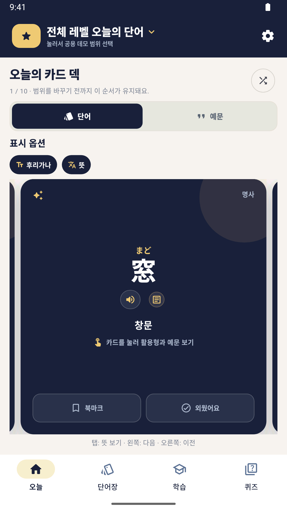
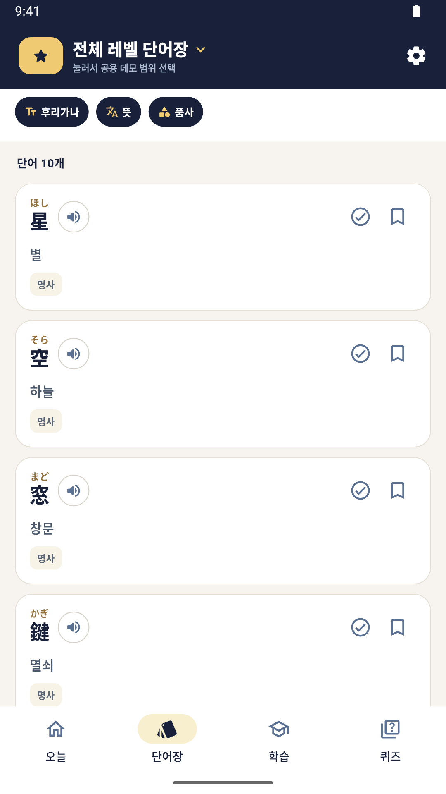
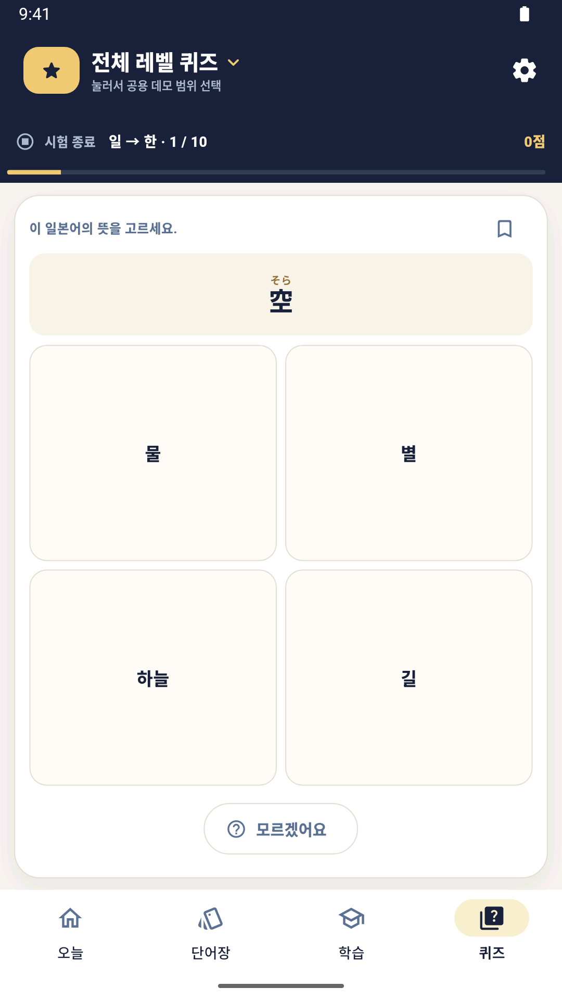

# 별빛 단어 · 공개 데모

일본어 학습 앱의 화면과 학습 흐름을 체험하는 Flutter 기반 Android/iOS 소스 데모입니다. 다섯 주제에 두 개씩 새로 작성한 단어 총 10개, 문법 카드 2개, 회화 뉘앙스 카드 1개를 제공합니다. `데모 1~5`는 주제 묶음이며 JLPT 공식 급수나 난도 분류가 아닙니다. 내부 `n5`~`n1` 키는 기존 UI 구조와 호환되는 저장 식별자입니다.

## 스크린샷

Android 에뮬레이터에서 공개 데모를 실행해 촬영했습니다. 이미지를 누르면 원본 크기로 볼 수 있습니다.

| 오늘 | 단어장 | 퀴즈 |
| :---: | :---: | :---: |
| <a href="docs/screenshots/home.png"></a> | <a href="docs/screenshots/vocabulary.png"></a> | <a href="docs/screenshots/quiz.png"></a> |

## Android 실행

Flutter **3.41.8**(Dart 3.11.5), Android SDK와 JDK 17을 준비하고 이 저장소 루트에서 실행합니다. `pubspec.lock`은 이 Flutter SDK의 테스트 의존성 버전을 기준으로 고정합니다.

```sh
flutter pub get
flutter run
```

Android 기기 또는 에뮬레이터를 연결해야 합니다. Flutter가 로컬 Android 설정과 Gradle 실행 파일을 생성합니다. SDK 경로, Gradle wrapper JAR, 빌드 결과와 서명 파일은 저장소에 포함하지 않습니다. 앱 ID는 `app.shinbi.tsuki_words.demo`이므로 원본 앱과 별도로 설치됩니다.

```sh
flutter analyze
flutter test
flutter build apk --debug
```

## iOS 빌드 및 실행

macOS, Flutter **3.41.8**(Dart 3.11.5), Xcode와 CocoaPods가 필요합니다. 최소 지원 버전은 **iOS 15.0**입니다. Xcode를 한 번 실행해 라이선스·추가 구성요소 설치를 끝내고 iOS Simulator 런타임을 준비하세요.

```sh
flutter pub get
flutter build ios --simulator --debug
flutter devices
flutter run -d <iOS-시뮬레이터-ID>
```

시뮬레이터는 Apple 개발자 계정이나 서명이 필요하지 않습니다. Xcode에서 열 때는 `ios/Runner.xcodeproj`가 아니라 아래 workspace를 사용합니다.

```sh
open ios/Runner.xcworkspace
```

실기기용 Release 컴파일만 확인하려면 다음 명령을 사용합니다. 이 결과는 **미서명 앱**이며, 그대로 iPhone에 설치하거나 App Store에 제출할 수 없습니다.

```sh
flutter build ios --release --no-codesign
```

실제 iPhone 설치는 Xcode의 Runner → Signing & Capabilities에서 본인의 Team을 선택하고 기기를 연결한 뒤 실행하세요. 저장소에는 특정 개발자의 Team이나 인증서를 넣지 않습니다. iOS bundle ID는 `app.shinbi.tsuki-words.demo`이며 Android 앱 ID와 구분됩니다. 자신의 Team에서 해당 ID를 사용할 수 없다면 고유한 ID로 변경해야 합니다.

단어·예문·퀴즈·학습 기록은 공통 Flutter 화면을 사용합니다. **홈/잠금화면 위젯, 라이브 배경화면, 일본어 TTS는 현재 Android 전용**이며 이번 iOS 빌드 설정에 네이티브 기능 이식은 포함하지 않습니다. iOS 앱 아이콘은 기존 Android의 자체 별 벡터를 PNG로 변환한 것입니다.

### 시뮬레이터 구성요소 불일치

`CoreSimulator is out of date`가 나오면 앱 소스가 아니라 Xcode와 설치된 CoreSimulator 버전이 맞지 않는 상태입니다. Xcode에서 추가 구성요소 설치를 완료해야 하며, 관리자 인증이 필요할 수 있습니다. Apple Silicon Mac에서 ARM64 컴파일만 따로 검증하려면 다음 명령을 사용할 수 있습니다. 이 명령의 성공이 시뮬레이터 런타임 설치 완료를 뜻하지는 않습니다.

```sh
flutter pub get
(cd ios && pod install)
xcodebuild -workspace ios/Runner.xcworkspace -scheme Runner \
  -configuration Debug -sdk iphonesimulator \
  -destination 'generic/platform=iOS Simulator' \
  -derivedDataPath build/ios/simulator-derived \
  ARCHS=arm64 ONLY_ACTIVE_ARCH=YES CODE_SIGNING_ALLOWED=NO
```

### 자동 검사

GitHub Actions의 `iOS build`는 PR, main push, 수동 실행에서 정적 분석·Flutter 테스트·시뮬레이터 Debug 빌드·미서명 실기기 Release 빌드를 수행합니다. 배포나 App Store 업로드는 하지 않으며 Apple 서명 secret도 사용하지 않습니다.

## 체험 기능

- 단어 카드, 후리가나, 예문, 검색, 북마크 및 외운 단어 표시
- 퀴즈, 학습 기록, 문법·회화 카드
- 데모 단어장과 일치하는 표현을 찾는 문장 분석. 예를 들어 `紙に星を描きます。`를 입력하면 수록 단어인 `紙`, `星`을 찾습니다.
- Android 홈·잠금화면 위젯과 라이브 배경화면
- 기기에 설치된 Android TTS를 이용한 일본어 읽기

위젯·잠금화면 지원은 Android 버전과 런처에 따라 다릅니다. TTS는 기기에 일본어 음성이 설치되어 있어야 합니다. 사용자 학습 상태는 기기에 저장합니다. 첫 실행은 모든 주제를 선택하며, 4지선다 퀴즈에는 선택 범위 안에 서로 다른 단어가 최소 4개 필요합니다.

## 포함 범위

어휘, 예문, 번역, 문법·뉘앙스 설명은 이 공개본을 위해 새로 작성했습니다. 원본의 외부 사전·예문·악센트 데이터, 데이터 생성 도구, 외부 글꼴·그림, VOICEVOX 엔진·모델·사전과 APK는 포함하지 않습니다. 시스템 글꼴을 사용하며 앱·위젯 아이콘은 간단한 자체 벡터입니다. 데모 데이터에는 악센트와 활용표가 없으므로 해당 표시 기능은 비어 있습니다.

Flutter와 `shared_preferences`를 사용합니다. 앱의 설정 → 데이터 출처와 이용 안내 → 소프트웨어 라이선스에서 패키지 고지를 볼 수 있습니다.

코드·데모 콘텐츠의 권리는 [RIGHTS.md](RIGHTS.md), 의존성 고지는 [THIRD_PARTY_NOTICES.md](THIRD_PARTY_NOTICES.md)를 참고하세요.
